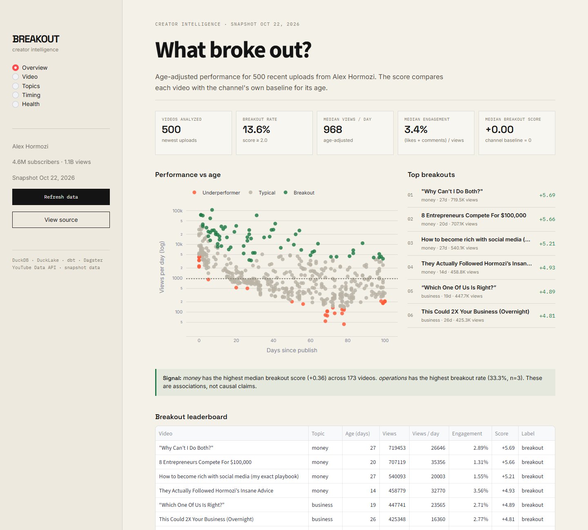

# Breakout: creator growth intelligence

Breakout is a local-first lakehouse for public YouTube data. It ingests a channel with quota-aware scheduling, preserves every API response in an immutable raw layer, writes bronze tables to DuckLake, models creator performance with dbt, orchestrates the graph in Dagster, and exposes the result through a five-page Streamlit product and a 10-check SLO command.

```powershell
uv sync
uv run breakout ingest --channel AlexHormozi --max-videos 500
uv run breakout build
uv run breakout status
uv run breakout health
uv run breakout dashboard
```

The build includes ingestion, DuckLake bronze, dbt staging, an SCD2 `dim_video` snapshot, gold marts for video performance, channel overview, publish timing, topic performance, and snapshot deltas, a Dagster asset graph with checks and a daily schedule, a Streamlit dashboard, and a shared SLO evaluator.



### Dashboard

`uv run breakout dashboard` opens the Streamlit app. Pages: Overview, Video deep dive, Topics, Timing, and Pipeline health. The app reads the local lakehouse; the screenshot above is a snapshot, not a live feed.

### Results (snapshot, 2026-10-23)

| Metric | Value |
|---|---|
| Videos analyzed | 507 |
| Video snapshots | 1,510 |
| Comments | 423 |
| dbt models and tests | 37 nodes |
| Automated tests | 49 |
| SLO checks | 10 |
| Governed metrics | 8 |
| Quota per 500-video refresh | 41 of 8,000 usable units |
| DuckLake / raw landing | 2.5 MB / 7.1 MB |
| Warm dashboard queries | 12–21 ms |
| Synthetic 100M-row group-by | 0.31 s |
| dbt build | 10.5 s |
| Local compute cost | $0 |

### Docs

- [Architecture](docs/architecture.md)
- [Benchmark](docs/benchmark.md)
- [Governed metrics and MCP](docs/metrics.md)
- [Snowflake parity path](docs/snowflake-parity.md)
- [ADRs](docs/adr/) — batch vs streaming, DuckLake vs Iceberg, Dagster vs Airflow, DuckDB vs Snowflake, metric registry, raw landing
- [Runbook](docs/runbook.md)
- [Postmortem: DuckLake path mismatch](docs/postmortem-001-ducklake-path.md)
- [3-minute demo script](docs/demo-script.md)
- [Interview story bank](docs/interview-stories.md)
- [Resume bullets](docs/resume-bullets.md)
- [2026 research and 14-day plan](docs/2026-flagship-plan.md)

### Orchestration

```powershell
$env:DAGSTER_HOME="$PWD\.dagster_home"
uv run dagster dev -m breakout.definitions
```

Open `http://localhost:3000`. The `daily_refresh` job runs ingestion, dbt, and the pipeline health asset at 06:00 UTC. Asset checks cover bronze rows, quota budget, and non-empty marts.

### Reliability

`uv run breakout health` evaluates freshness, quota, quarantine, mart coverage, key uniqueness, null scores, and dbt failures. It exits non-zero on error-severity failures and supports `--json` for automation.

Malformed API items are written to `lake.bronze.quarantine` instead of being dropped silently. The raw response is always preserved, so a parser fix can replay without another API call.

The failure-mode runbook is in `docs/runbook.md`.

### Governed metrics and MCP

`uv run breakout metrics` lists eight owned metrics. `uv run breakout metric breakout_rate` runs one. The same registry is exposed through an MCP server (`uv run breakout-mcp`) with `list_metrics`, `describe_metric`, and `query_metric`. The agent can only execute registered definitions, not raw SQL.

```json
{
  "mcpServers": {
    "breakout": {
      "command": "uv",
      "args": ["run", "--directory", "C:/path/to/production-data-pipeline", "python", "-m", "breakout.mcp_server"]
    }
  }
}
```

See `docs/metrics.md` for the metric list, guardrails, and example flow.

### Backfills

The public API exposes current lifetime statistics only. Re-running ingestion appends a new snapshot, but it cannot reconstruct historical view counts. Backfills apply to dbt models over existing bronze data, not to the source.

### Status

Core pipeline, marts, orchestration, dashboard, SLOs, the 100M-row scale probe, and the governed metric/MCP layer are complete. Next: RAG and the eval harness (#15), and a credentialed Snowflake parity run (#16).

The legacy sample pipelines below remain runnable.

---

## Legacy: sample orders pipeline

Sample extract, transform, and load job for paid orders.

`data/sample_orders.csv` is the source. The pipeline drops refunds, blank customers, non-positive quantities, and duplicate order ids, then upserts the remaining lines into SQLite at `data/output/orders.db`.

## Run

```bash
python -m pipeline.run
```

Optional paths:

```bash
python -m pipeline.run --source data/sample_orders.csv --database data/output/orders.db
```

## YouTube search

Uses a YouTube Data API v3 key from `.env` (see `.env.example`). `.env` is gitignored.

```powershell
python -m pipeline.youtube --query "data pipeline" --max-results 5
```

Results land in `data/output/youtube.db`.

To load the same rows into Snowflake, fill in the `SNOWFLAKE_*` values in `.env`, install dependencies, and choose that destination:

```powershell
pip install -e .
python -m pipeline.youtube --destination snowflake --query "data pipeline" --max-results 5
```

The job opens a Snowpark session, creates `YOUTUBE_VIDEOS`, and merges a DataFrame on `VIDEO_ID`.

## Test

```bash
python -m unittest tests.test_pipeline tests.test_youtube tests.test_snowflake
```
