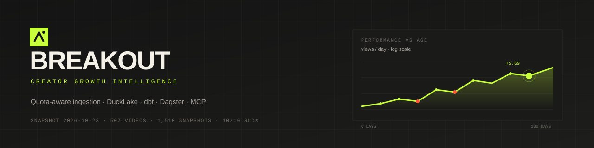
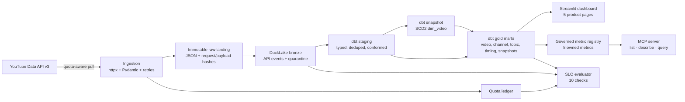

<p align="center">
  
</p>

<h1 align="center">Breakout</h1>

<p align="center">
  <strong>Creator growth intelligence, built like a data product.</strong><br/>
  Quota-aware ingestion → immutable raw landing → DuckLake bronze → dbt marts → Dagster → Streamlit + SLOs + MCP.
</p>

<p align="center">
  <a href="https://github.com/Lucimad007/production-data-pipeline/actions/workflows/ci.yml">
    
  </a>
  
  
  
  
</p>

<p align="center">
  
  
  
  
  
  
  
  
</p>

<p align="center">
  <a href="#the-problem">The problem</a> ·
  <a href="#what-it-does">What it does</a> ·
  <a href="#results">Results</a> ·
  <a href="#architecture">Architecture</a> ·
  <a href="#quickstart">Quickstart</a> ·
  <a href="#docs">Docs</a> ·
  <a href="#roadmap">Roadmap</a>
</p>

> **TL;DR** — A local-first lakehouse that turns 500+ public YouTube uploads into age-adjusted breakout scores, topic and timing signals, a five-page dashboard, and 10 executable SLO checks. Built with DuckDB, DuckLake, dbt, Dagster, Streamlit, and a governed MCP metric server. **49 tests. 10/10 SLOs. $0 local compute.**

---

## The problem

Most creator dashboards stop at views. That is not a decision. A two-year-old evergreen video can be more valuable than a two-day spike, a high-view video can have terrible engagement, and “post on Friday” is a correlation, not a strategy.

Most AI demos stop at raw text-to-SQL. That is not a product. An agent that invents a join or treats a hidden count as zero is worse than no agent.

Most portfolio pipelines stop at “it ran once.” That is not engineering. There is no replay, no contract, no failure story, and no number you can defend.

Breakout is a response to all three.

## What it does

| Layer | Implementation | Why it matters |
|---|---|---|
| **Source** | YouTube Data API v3 | Real, messy, quota-limited data |
| **Ingestion** | Python, httpx, Pydantic, retries | Quota accounting and typed contracts |
| **Raw landing** | Immutable JSON + request/payload hashes | Replay and audit without re-fetching |
| **Bronze** | DuckLake + DuckDB | ACID, time travel, schema evolution |
| **Silver** | dbt staging + SCD2 `dim_video` | Typed history, not just current state |
| **Gold** | Five dbt marts | Video, channel, topic, timing, snapshot deltas |
| **Orchestration** | Dagster assets, checks, daily schedule | Lineage and run metadata you can see |
| **Product** | Streamlit + Plotly | Five pages that end in a decision |
| **Reliability** | `breakout health`, 10 SLOs, runbook | The pipeline can say when it is wrong |
| **AI surface** | Governed metric registry + MCP 2.x | Agents query definitions, not raw tables |

## Demo

<p align="center">
  
</p>

<p align="center">
  <em>Overview: age-adjusted performance, breakout leaderboard, and a data-derived signal callout.</em>
</p>

The five pages are **Overview**, **Video deep dive**, **Topics**, **Timing**, and **Pipeline health**. The app reads the local lakehouse; the screenshot is a snapshot, not a live feed. For the full walkthrough, see the [3-minute demo script](docs/demo-script.md).

## Results

Snapshot from **2026-10-23**. Re-run `uv run python scripts/benchmark.py` for current numbers.

| Metric | Value |
|---|---|
| Videos analyzed | **507** |
| Video snapshots | **1,510** |
| Comments | **423** |
| Breakout rate | **13.4%** |
| dbt models and tests | **37 nodes** |
| Automated tests | **49** |
| SLO checks | **10** |
| Governed metrics | **8** |
| Quota per 500-video refresh | **41 of 8,000 usable units** |
| DuckLake / raw landing | **2.6 MB / 7.1 MB** |
| Warm dashboard queries | **12–21 ms** |
| Cold query (attach + query) | **189–363 ms** |
| Synthetic 100M-row group-by | **0.31 s** |
| dbt build | **10.5 s** |
| Local compute cost | **$0** |

## Architecture



**Key invariants**

- **Raw is immutable.** A parser bug never requires another API call.
- **Writes are idempotent.** Replaying a collection changes no row counts.
- **Quota is bounded.** The ledger refuses calls above 80% of the daily budget.
- **Bad rows are quarantined, not dropped.** The raw payload stays available.
- **Metrics are age-adjusted.** Raw views/day would punish evergreen videos.
- **AI is governed.** The agent can only query registered metrics.

## Why this is different

- **Quota is a first-class constraint, not an afterthought.** A 500-video refresh with comments costs 41 units because the client pages the uploads playlist and batches 50 video IDs per call.
- **The raw layer is the source of truth.** Every response is written before parsing, so bronze can be rebuilt and a schema fix can replay without spending quota.
- **The score is age-adjusted.** A robust z-score over `log1p(views)` compares each video with its channel’s own baseline for the same age bucket. Raw views/day would reward recency.
- **Failure is visible.** Malformed items go to `lake.bronze.quarantine`; 10 SLOs check freshness, quota, coverage, keys, nulls, and dbt failures.
- **The AI surface is governed.** Eight authored metrics with owner, grain, dimensions, and examples. No raw text-to-SQL.
- **The tradeoffs are written down.** Six ADRs cover batch vs streaming, DuckLake vs Iceberg, Dagster vs Airflow, DuckDB vs Snowflake, the metric registry, and raw-first ingestion.

## Quickstart

**Prerequisites:** Python 3.12+, [uv](https://docs.astral.sh/uv/), and a YouTube Data API v3 key.

```powershell
git clone https://github.com/Lucimad007/production-data-pipeline.git
cd production-data-pipeline
uv sync
Copy-Item .env.example .env
# Add YOUTUBE_API_KEY to .env
uv run breakout ingest --channel AlexHormozi --max-videos 500 --comment-videos 20
uv run breakout build
uv run breakout status
uv run breakout health
uv run breakout dashboard
```

Expected ingest shape:

```text
channel=Alex Hormozi id=UCUyDOdBWhC1MCxEjC46d-zw
videos=500 comments=400 quarantined=0
quota_units=41
raw_files=41
written=channels:1 videos:500 video_snapshots:500 comments:400 quarantine:0
```

### Dagster

```powershell
New-Item -ItemType Directory -Force .dagster_home
$env:DAGSTER_HOME="$PWD\.dagster_home"
uv run dagster dev -m breakout.definitions
```

Open `http://localhost:3000`. The `daily_refresh` job runs ingestion, dbt, and the health asset at 06:00 UTC.

### Governed metrics + MCP

```powershell
uv run breakout metrics
uv run breakout metric breakout_rate
uv run breakout-mcp
```

```text
              channel_id  breakout_rate  videos
UCUyDOdBWhC1MCxEjC46d-zw       0.134122     507
```

MCP client config:

```json
{
  "mcpServers": {
    "breakout": {
      "command": "uv",
      "args": ["run", "--directory", "C:/path/to/production-data-pipeline", "python", "-m", "breakout.mcp_server"]
    }
  }
}
```

## The data model

| Layer | Table | Grain |
|---|---|---|
| Bronze | `api_responses` | One API response, hashed |
| Bronze | `channels` | Channel + snapshot time |
| Bronze | `videos` | One current video record |
| Bronze | `video_snapshots` | Video + snapshot time |
| Bronze | `comments` | One comment, hashed author |
| Bronze | `quarantine` | Rejected item + reason |
| Silver | `dim_video` | SCD2 video versions |
| Gold | `mart_video_performance` | One video |
| Gold | `mart_channel_overview` | One channel |
| Gold | `mart_topic_performance` | Channel + topic |
| Gold | `mart_publish_timing` | Channel + day + hour |
| Gold | `mart_video_snapshots` | Video + snapshot delta |

## Reliability

| SLO | Target |
|---|---|
| Bronze videos present | > 0 |
| Snapshots present | > 0 |
| Comments present | > 0 |
| Freshness | < 6 hours |
| Quota | ≤ 80% of daily budget |
| Quarantine | 0 items (warn) |
| Mart coverage | > 95% of bronze videos |
| Mart keys | 0 duplicates |
| Breakout scores | 0 nulls |
| dbt failures | 0 |

```powershell
uv run breakout health
uv run breakout health --json
```

Latest run: **10/10 PASS**. The command exits non-zero only on error-severity failures. Quarantine and missing dbt artifacts are warnings, not hard stops.

The [runbook](docs/runbook.md) covers quota exhaustion, dbt test failures, schema drift/quarantine, and stale data. The [DuckLake postmortem](docs/postmortem-001-ducklake-path.md) documents a real build-blocking incident and its prevention.

## Benchmarks

| Probe | Result |
|---|---|
| `dbt build` (37 nodes) | 10.5 s |
| Warm channel overview | 13.8 ms |
| Warm breakout leaderboard | 19.4 ms |
| Cold query (attach + query) | 189–363 ms |
| 10M-row group-by | 34.6 ms |
| 100M-row group-by | 308.5 ms |
| 100M-row RSS | 2,504 MB |
| SLO evaluation (10 checks) | ~1.0 s |

Hardware: Windows 11, Intel i5-13400F, 32 GB RAM, Python 3.12.9, DuckDB 2.0.0, dbt 1.12.6. Full methodology: [benchmark](docs/benchmark.md).

## Docs

| Doc | What it answers |
|---|---|
| [Architecture](docs/architecture.md) | How the system fits together |
| [Benchmark](docs/benchmark.md) | How fast, how big, and on what hardware |
| [ADRs](docs/adr/) | Why batch, DuckLake, Dagster, DuckDB, a registry, and raw-first |
| [Runbook](docs/runbook.md) | What to do when it breaks |
| [Postmortem](docs/postmortem-001-ducklake-path.md) | A real incident, root cause, and prevention |
| [Metrics + MCP](docs/metrics.md) | The governed agent surface and guardrails |
| [Snowflake parity](docs/snowflake-parity.md) | The portability path and its credential blocker |
| [Demo script](docs/demo-script.md) | A 3-minute walkthrough |
| [Interview stories](docs/interview-stories.md) | Eight STAR stories mapped to loops |
| [Resume bullets](docs/resume-bullets.md) | Honest, number-backed bullets |
| [2026 plan](docs/2026-flagship-plan.md) | The research and 14-day build plan |

## What I deliberately did not build

- **No Kafka/Flink.** The source is polled. Daily micro-batches are the honest architecture; streaming would be theater.
- **No fake Snowflake parity.** The target, dialect macros, and cost model are ready, but the credentials are placeholders. The run is documented, not claimed.
- **No RAG/evals claim.** The governed metric registry and MCP server are real. The LLM client, retrieval, and eval harness are the remaining AI work.
- **No production-scale claim.** This is portfolio-scale with production-shaped practices: contracts, replay, quarantine, SLOs, and a runbook.
- **No dashboard sprawl.** Five pages, each tied to a decision.

## Roadmap

- [x] Quota-aware ingestion with raw landing
- [x] DuckLake bronze with idempotent writes and quarantine
- [x] dbt staging, SCD2, age-adjusted gold marts
- [x] Dagster assets, checks, and daily schedule
- [x] Five-page Streamlit product
- [x] 10 SLO checks + runbook
- [x] 100M-row scale probe
- [x] Governed metrics + MCP server
- [x] Architecture, ADRs, postmortem, benchmark, interview assets
- [ ] RAG over comments/transcripts + eval harness ([#15](https://github.com/Lucimad007/production-data-pipeline/issues/15))
- [ ] Credentialed Snowflake parity run ([#16](https://github.com/Lucimad007/production-data-pipeline/issues/16))
- [ ] Live deployment / recorded demo
- [ ] Incremental marts and partition pruning
- [ ] Cube or dbt Semantic Layer when multiple teams need the same definitions

## Repository map

```text
.
├── src/breakout/
│   ├── contracts.py        Pydantic API contracts
│   ├── youtube.py          quota-aware client + ledger
│   ├── storage.py          raw landing + DuckLake bronze
│   ├── pipeline.py         shared ingest/build operations
│   ├── definitions.py      Dagster assets, checks, schedule
│   ├── dashboard.py        Streamlit product surface
│   ├── health.py           10 SLO checks
│   ├── metrics.py          governed metric registry
│   ├── mcp_server.py       MCP 2.x server
│   └── cli.py              breakout command
├── dbt_project/
│   ├── models/staging/     typed, deduped views
│   ├── models/intermediate/int_video_performance.sql
│   ├── models/marts/       gold tables
│   ├── snapshots/          SCD2 dim_video
│   └── macros/dialect.sql  DuckDB/Snowflake dispatch
├── metrics/                YAML metric definitions
├── tests/                  49 tests + deterministic dbt fixture
├── scripts/benchmark.py    reproducible local benchmark
├── docs/                   architecture, ADRs, runbook, stories
└── pipeline/               legacy sample pipelines
```

## License

MIT. See [LICENSE](LICENSE).

Built with [DuckDB](https://duckdb.org/), [DuckLake](https://ducklake.select/), [dbt](https://www.getdbt.com/), [Dagster](https://dagster.io/), [Streamlit](https://streamlit.io/), and the [Model Context Protocol](https://modelcontextprotocol.io/). Data from the [YouTube Data API](https://developers.google.com/youtube/v3).

---

<details>
<summary><strong>Legacy sample pipelines</strong> (kept for reference)</summary>

### Sample orders pipeline

Sample extract, transform, and load job for paid orders.

`data/sample_orders.csv` is the source. The pipeline drops refunds, blank customers, non-positive quantities, and duplicate order ids, then upserts the remaining lines into SQLite at `data/output/orders.db`.

```bash
python -m pipeline.run
```

Optional paths:

```bash
python -m pipeline.run --source data/sample_orders.csv --database data/output/orders.db
```

### YouTube search

Uses a YouTube Data API v3 key from `.env` (see `.env.example`). `.env` is gitignored.

```powershell
python -m pipeline.youtube --query "data pipeline" --max-results 5
```

Results land in `data/output/youtube.db`.

To load the same rows into Snowflake, fill in the `SNOWFLAKE_*` values in `.env`, install dependencies, and choose that destination:

```powershell
pip install -e .
python -m pipeline.youtube --destination snowflake --query "data pipeline" --max-results 5
```

The job opens a Snowpark session, creates `YOUTUBE_VIDEOS`, and merges a DataFrame on `VIDEO_ID`.

### Legacy tests

```bash
python -m unittest tests.test_pipeline tests.test_youtube tests.test_snowflake
```

For the current suite, use `uv run pytest -q`.

</details>
