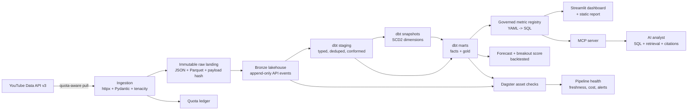

# Breakout: the 2026 flagship plan

**Thesis:** The pipeline that gets you hired in 2026 is not the one with the most logos in the README. It is the one that proves you can own a data product end to end: real data, real users, real failure modes, measured outcomes, and an AI interface that is governed rather than demoed.

This document is the research brief, architecture, and build plan for turning the existing YouTube pipeline into that product.

---

## 1. What actually changed by October 2026

| Layer | Current state of the art | Why it matters | Hype check |
|---|---|---|---|
| Table format | Apache Iceberg v3 (1.12 released Sept 29, 2026); DuckLake 1.0 (Apr 2026), 1.1 (Oct 2026) | ACID tables, time travel, schema evolution, hidden partitioning. Iceberg v3 adds deletion vectors, row lineage, variant, and a mature REST catalog story. | Most companies still run Iceberg v2. Do not claim v3 unless you actually use a v3 feature. |
| Catalog | REST catalog: Lakekeeper, Apache Polaris, Unity Catalog OSS, BigQuery BigLake | Decouples compute from metadata; one catalog can serve DuckDB, Trino, Spark, Flink, Snowflake. Vended credentials are becoming standard. | Hive Metastore is legacy. A local SQL catalog is fine for a portfolio, but know why REST is the production answer. |
| Transformation | dbt v2 (Fusion engine) went GA on Sept 16, 2026; SQLMesh is the credible alternative | Rust runtime, SQL comprehension before execution, static analysis, column-level lineage, Parquet-based dbt Information Schema. | dbt v1 is still everywhere. Adapter support lags. Use what your target employers use, and explain the pin. |
| Orchestration | Airflow 3.3 (assets, partitions, state store, multi-language task SDK); Dagster (asset checks, lineage, partitions) | Asset-centric scheduling, first-class backfills, observable data dependencies. | About 20% of teams still have no orchestration. Tool choice is less important than ownership and failure handling. |
| Compute | DuckDB 1.5, Trino, Spark 4, ClickHouse | DuckDB makes a single laptop feel like a warehouse. Spark is for scale, not for 50 MB. | "Big data" tooling on small data is a negative signal, not a positive one. |
| Streaming | Flink 2.x, Kafka 4.x (KRaft-only) | True event-time processing, watermarks, exactly-once sinks. | Polling an API every 15 minutes is not streaming. Do not fake it. |
| AI for data | Semantic layer + MCP + evaluation harness | Agents need governed metrics, context, and guardrails. Raw text-to-SQL against raw tables is how you get plausible wrong answers. | A chatbot demo is noise. An eval harness with documented failures is signal. |
| Observability | OpenLineage, dbt tests, Dagster asset checks, data diff | Trust is the product. Freshness, volume, schema, and distribution checks must be automated. | A dashboard nobody owns is theater. |

### The hiring signal behind the tooling

From the 2026 State of Data Engineering survey (1,101 respondents, Feb 2026):

- **82%** use AI tools daily or more; only about **10%** say AI is embedded in most workflows. Individual adoption is far ahead of organizational adoption.
- **44%** run a cloud data warehouse as their primary environment; **27%** run a lakehouse. Architecture is converging, not fragmenting.
- **90%** report at least one data-modeling pain point; **26%** say firefighting consumes significant time.
- **42%** expect their data team to grow in 2026; **7%** expect it to shrink.
- The most requested training topics are AI/LLM integration, data modeling, and semantics/ontologies/knowledge graphs.

From Datafold's 2026 predictions (Mar 2026):

- Data and analytics job postings were down **15.2% year over year** through October 2025, versus **8.5%** for tech overall.
- The market is turbulent, but demand for people who can architect systems, define governance, and use agents safely is stronger than demand for pipeline plumbers.
- Agentic development is real, but enterprise adoption is slow because of security and data-access constraints.

**Interpretation:** the bar moved. "I can write a dbt model and schedule it" is table stakes and increasingly automatable. The differentiator is evidence that you can:

1. Frame a business problem and choose the right architecture for it.
2. Make data correct, fresh, reproducible, and cheap to operate.
3. Handle failure, schema change, late data, and backfills without drama.
4. Expose data safely to humans and agents through governed semantics.
5. Measure the result and explain the tradeoffs.

That is the project.

---

## 2. The trap most portfolios fall into

A hiring manager sees hundreds of repos like this:

- A CSV or Kaggle dataset that has been used ten thousand times.
- A Python script, a dbt project, an Airflow DAG, and a screenshot.
- No tests, no CI, no data contracts, no failure story, no users.
- A README that lists tools but never says what decision the data changed.
- A chatbot that writes raw SQL against raw tables and confidently returns wrong numbers.

That profile now reads as "tutorial recycler." The tools are not the problem. The absence of ownership is.

**What reviewers actually score** (synthesized from 2026 portfolio guidance):

- Real problem, stated in business terms.
- Real, messy data from a source you actually collected.
- Modern tools used with justified tradeoffs, not name-dropped.
- Clean, modular code with tests and reproducible environments.
- Documentation: README, architecture diagram, run instructions, results.
- End-to-end depth: ingestion through consumption, not a single script.
- Automation, data quality, error handling, and scheduling.
- Evidence of impact: numbers, benchmarks, before/after.
- Presentation: a live demo, screenshots, a video, a write-up.

One deep, coherent project beats five shallow ones. The goal is not "more projects." The goal is one project that gives you a story for every interview loop.

---

## 3. The flagship: Breakout

**One-liner:** A creator growth intelligence platform that explains why videos break out and what to publish next.

**Why this domain:**

- The YouTube Data API is real, free, documented, and rate-limited. Quota is a genuine engineering constraint.
- The data is messy in useful ways: hidden like counts, deleted videos, changed titles, late-arriving statistics, pagination duplicates, timezone ambiguity.
- The business questions are obvious to a non-technical reviewer, which makes the demo legible in 60 seconds.
- It extends the existing repository instead of throwing it away.
- Comments and transcripts give you a real text corpus for retrieval and evaluation, not a toy PDF.

**The five questions the product answers:**

1. Which uploads over- or under-perform the channel baseline, and by how much?
2. What attributes correlate with breakout: topic, length, publish time, title pattern, early velocity?
3. Which topics are viewers asking for in comments but the channel has not covered?
4. What is the 7-day view forecast for a new upload, with uncertainty?
5. Which videos are still accelerating, and which are decaying?

**What makes it different from a YouTube dashboard:**

- It is a decision system, not a chart gallery. Every page ends in a recommendation.
- It has a governed metric registry. The AI can only query metrics that a human has defined and tested.
- It has a forecast with a backtest and a naive baseline, not a hand-wavy "ML model."
- It has a pipeline health page with freshness, quota, cost, and data quality.
- It has documented failure modes and a postmortem. That is what senior engineers talk about in interviews.

---

## 4. Architecture



### Architecture principles

1. **Raw is immutable.** Every API response lands with request metadata, fetch time, and a payload hash. You can rebuild every downstream table without calling the API again.
2. **Idempotent by construction.** Natural keys plus merge semantics plus content hashes. Replaying the same page five times changes nothing.
3. **Contracts at the boundary.** Pydantic models define what the API returns and what the warehouse expects. Schema drift is detected, quarantined, and alerted, not silently coerced.
4. **Partition by event date, not ingest date.** Late-arriving stats recompute the affected partitions. Backfills are a first-class operation, not a script someone wrote at 2 a.m.
5. **Metrics are code.** Every metric has an owner, a definition, a grain, a test, and an example. The AI cannot invent a metric.
6. **AI sees only governed surfaces.** The agent gets a metric tool and a retrieval tool. It does not get `SELECT *` on raw tables.
7. **Every claim has a measurement.** Runtime, rows, quota units, cost, freshness, test pass rate, forecast error, eval score. No adjectives without numbers.
8. **Batch is a deliberate choice.** The source updates on the order of minutes to hours. A 15-minute micro-batch is simpler, cheaper, and more reliable than a streaming cluster. Add streaming only when there is a real event source, and document the decision.

---

## 5. Data model

### Landing and bronze

| Table | Grain | Key | Notes |
|---|---|---|---|
| `raw.api_responses` | one API request | `request_hash` | Endpoint, params, status, fetched_at, payload, payload_hash |
| `raw.channel_snapshots` | channel + snapshot hour | `(channel_id, snapshot_at)` | Subscriber count, video count, view count |
| `raw.video_snapshots` | video + snapshot hour | `(video_id, snapshot_at)` | Views, likes, comments; nullable when hidden |
| `raw.comments` | one comment | `comment_id` | Thread, author hash, text, like count, published_at |
| `raw.transcripts` | one video | `video_id` | Optional; segments with start seconds |

### Silver

| Model | Grain | Strategy |
|---|---|---|
| `stg_channels` | channel | View, typed, deduped |
| `stg_videos` | video | View, typed, deduped |
| `stg_video_snapshots` | video + snapshot hour | Incremental merge; dedupe on key |
| `stg_comments` | comment | Incremental merge; author hashed |
| `dim_channel` | channel | SCD2 snapshot |
| `dim_video` | video | SCD2 snapshot for title, description, tags, duration |
| `fct_video_snapshot` | video + snapshot hour | Incremental fact |
| `fct_comment` | comment | Incremental fact |

### Gold

| Mart | Grain | Business question |
|---|---|---|
| `mart_video_performance` | video | Latest stats, 24h/48h/7d velocity, engagement rate, breakout z-score |
| `mart_channel_growth` | channel + day | Subscriber and view growth, 7d/28d moving averages |
| `mart_topic_performance` | topic + cohort | Median views, breakout rate, engagement, sample size |
| `mart_publish_timing` | day-of-week + hour | Median 7d views, lift vs channel baseline, confidence interval |
| `mart_content_gaps` | topic | Comment demand score vs published supply, opportunity rank |
| `mart_creator_scorecard` | channel + week | Health metrics and trend deltas |
| `ml.breakout_predictions` | video | 7d forecast, lower/upper bound, model version, features |

### Key definitions

- **View velocity:** views gained per hour since publish, computed from consecutive snapshots. Normalize for age.
- **Breakout score:** `(log1p(views_7d) - channel_baseline) / channel_baseline_sd`, computed within a channel and cohort. A score above 2 is a breakout; below -1 is an underperformer.
- **Engagement rate:** `(likes + comments) / views`, with nulls handled explicitly. Do not treat hidden counts as zero.
- **Topic:** a normalized theme derived from title, description, tags, and comment text. Start with keyword rules and clustering; add an LLM labeler only if it is evaluated.
- **Content gap:** high comment demand for a topic, low published supply in the last 90 days, weighted by channel fit.

---

## 6. Stack decisions

| Decision | Choice | Alternative | Why | When to switch |
|---|---|---|---|---|
| Orchestrator | Dagster OSS | Airflow 3.3 | Asset-centric graph, built-in lineage, asset checks, partitions, easy local run on Windows. The UI tells the story for you. | If the target employer is an Airflow shop, port the assets to an Airflow DAG. The logic lives in plain Python, so the port is mechanical. |
| Table format | Iceberg for the production story; DuckLake for the local dev loop | Delta Lake | Iceberg is the open standard and the strongest hiring signal. DuckLake 1.x gives a zero-ops local lakehouse with SQL metadata and fast iteration. Same dbt SQL, two engines. | If you need Spark/Flink/Trino interoperability today, use Iceberg everywhere. If you need the simplest local setup, DuckLake everywhere. |
| Compute | DuckDB locally; Snowflake optional for parity | Spark, Trino | DuckDB handles this data volume on a laptop with sub-second queries. Snowflake parity proves the SQL is portable. | When a single node is no longer enough or the team standard is a warehouse. |
| Transformation | dbt Core 1.12 with dbt-duckdb | dbt v2, SQLMesh | dbt is the most requested transformation skill. Pin v1 for adapter support, write v2-compatible SQL, and document the migration path. | When dbt v2 supports your adapter, move. If you want column-level lineage and virtual environments now, SQLMesh is excellent. |
| Metrics | A small governed metric registry in YAML | Cube, dbt Semantic Layer | You need a controlled surface for the AI, not a second product to operate. A registry with 15 tested metrics is enough to demonstrate the pattern. | When multiple teams need the same metrics, adopt Cube or the dbt Semantic Layer. |
| Dashboard | Streamlit | Evidence, Superset | Fast to build, interactive, easy to deploy. The product is the data model, not the CSS. | If you want BI-as-code and a static site, Evidence is a strong upgrade. |
| AI | Provider-agnostic agent + MCP server | Vendor agent | Shows you understand tool calling, guardrails, and evals. MCP makes the metrics usable from Claude, Cursor, or any compatible client. | When a vendor agent has native access to your catalog and passes your evals. |
| Vector store | DuckDB VSS | pgvector, Qdrant | No extra service; good enough for thousands of comments. Document the recall/latency tradeoff. | When you need multi-tenant isolation, high concurrency, or filtered ANN at scale. pgvector is the next step if Postgres is already there. |
| Streaming | None in v1; micro-batch | Kafka + Flink | The source is polled. A streaming cluster would be theater. | When you have a real event source (live chat, clickstream) or a sub-minute SLA. |

**Interview rule:** for every choice, be able to say what constraint drove it, what you gave up, and what would make you switch. That is the difference between "I used Dagster" and "I chose Dagster because assets, checks, and lineage are the product surface I need; Airflow would be the right call in a larger, more heterogeneous org."

---

## 7. Reliability engineering

This is the section that separates a portfolio from a production story.

### Contracts and schema drift

- Pydantic models for every API response; export JSON Schema to `contracts/`.
- Contract tests run against recorded fixtures and live responses.
- Unknown fields are allowed but logged; missing required fields quarantine the record.
- A deliberate drift test mutates a fixture and asserts that the pipeline rejects it, writes to a quarantine table, and raises an alert.

### Idempotency and replay

- Every request has a deterministic `request_hash`; every payload has a `payload_hash`.
- Bronze is append-only; duplicates are removed in silver by natural key.
- A replay test sends the same page five times and asserts row counts and checksums are unchanged.
- Backfills use the same code path as incremental runs, with a partition range argument.

### Late and corrected data

- YouTube statistics are cumulative and can be corrected. Model snapshots as event-time facts, not mutable current-state rows.
- A late snapshot triggers recomputation of the affected day's aggregates.
- `dim_video` is SCD2 so title and description changes do not rewrite history.

### Quota management

- YouTube Data API default quota is 10,000 units/day. `search.list` costs 100 units; most list endpoints cost 1.
- A quota ledger records units per endpoint per run. The scheduler refuses to start a job that would exceed 80% of the daily budget.
- Expensive discovery is cached; incremental refresh prioritizes videos that are still accelerating.
- A fake API returns 429 and quota errors in tests; the client backs off, resumes, and never duplicates rows.

### SLOs

| SLO | Target | Measurement |
|---|---|---|
| Freshness | p95 < 6 hours for active videos | `max(ingested_at) - max(snapshot_at)` |
| Pipeline success | > 99% of scheduled runs | Dagster run history |
| Data tests | 100% of blocking tests pass | dbt test results |
| Quota | < 80% of daily budget | Quota ledger |
| Cost | < $X per month | Warehouse + compute billing |
| AI answer quality | Faithfulness > 0.9; SQL correctness > 0.95 on golden set | Eval harness |

### Chaos tests

- API 500s and timeouts.
- 429 with `Retry-After`.
- Duplicate pagination pages.
- A video deleted between discovery and stats fetch.
- Hidden like/comment counts.
- A new required field in the response.
- A clock skew that produces a snapshot before its predecessor.
- A comment with emoji, RTL text, and a 10k-character body.

Each test asserts a specific behavior: retry, quarantine, dedupe, or recompute. This is the material for the "tell me about a failure" interview question.

### Observability and cost

- `ops.pipeline_runs`: run_id, asset, partition, status, rows_in, rows_out, bytes, duration, quota_units, error.
- `ops.asset_checks`: check name, status, observed value, threshold, severity.
- `ops.quota_ledger`: endpoint, units, run_id, remaining budget.
- A Pipeline Health page in the dashboard: freshness, row counts, failed checks, quota burn, cost per run, last 20 runs.
- Alerts to email/Slack/GitHub issue on failure or SLO breach.
- A cost benchmark: DuckDB local vs Snowflake (if credentials are available) for the same 1M-row workload.

---

## 8. The AI layer

The goal is not "chat with your data." The goal is a **governed analyst** that is measurably reliable.

### Why a metric registry comes first

Raw text-to-SQL fails in predictable ways: it picks the wrong table, invents a join, misreads a null, or defines "engagement" differently each time. A small semantic layer removes most of that failure surface.

`metrics/video_performance.yml`:

```yaml
- name: breakout_score
  description: >
    Standardized 7-day view performance versus the channel's trailing 90-day
    baseline, computed on log1p views. Higher is better. A score above 2 is a
    breakout; below -1 is an underperformer.
  grain: video
  owner: creator-intelligence
  sla: daily
  sql: |
    with baseline as (
      select channel_id,
             avg(ln(1 + views_7d)) as mu,
             stddev_samp(ln(1 + views_7d)) as sigma
      from {{ ref('mart_video_performance') }}
      where published_at >= current_date - interval '90 days'
      group by 1
    )
    select p.video_id,
           p.channel_id,
           (ln(1 + p.views_7d) - b.mu) / nullif(b.sigma, 0) as breakout_score
    from {{ ref('mart_video_performance') }} p
    join baseline b using (channel_id)
  dimensions: [channel_id, topic, published_week]
  examples:
    - "Which videos broke out in the last 30 days?"
    - "Is a score of 1.4 good for a channel with high variance?"
```

The registry is compiled into a read-only SQL surface. The agent can only call `query_metric` with a known metric, known dimensions, and a bounded time range.

### Agent tools

| Tool | Purpose | Guardrail |
|---|---|---|
| `list_metrics` | Discover available metrics | Returns only registered metrics |
| `describe_metric` | Definition, owner, grain, examples | No raw SQL |
| `query_metric` | Aggregated query with dimensions and filters | Max 10k rows; timeout; read-only; SQL AST validated |
| `search_content` | Hybrid retrieval over comments/transcripts | Returns citations with video_id and timestamp |
| `get_video` | Metadata and stats for one video | No PII |

### Guardrails

- Read-only database role.
- Only registered metrics and dimensions; no arbitrary table names.
- Row limit, timeout, and query cost estimate.
- SQL AST validation before execution.
- Citations for every retrieval claim.
- Refuse when the metric is undefined or the evidence is weak.
- Log every tool call, SQL, row count, latency, and response for audit.

### RAG over comments and transcripts

- Chunk comments by thread and transcripts by segment (30-60 seconds).
- Hybrid retrieval: BM25 + dense embeddings, reciprocal rank fusion.
- Store embeddings in DuckDB VSS; document the switch to pgvector/Qdrant when concurrency or filtering demands it.
- Evaluate retrieval recall on a golden set before evaluating the answer.
- Cite the video, timestamp, and comment ID. Never present a generated summary as a quote.

### Eval harness

Create 30 golden questions across five categories:

1. Simple metric lookup.
2. Time-window comparison.
3. Dimension breakdown.
4. Causal/qualitative question requiring retrieval.
5. Out-of-scope question that must be refused.

Measure:

- **SQL correctness:** does the query return the expected result on a fixed snapshot?
- **Answer faithfulness:** are claims supported by the returned rows or citations?
- **Answer relevance:** does it answer the question asked?
- **Refusal accuracy:** does it refuse when it should?
- **Latency and cost:** p50/p95, tokens, dollars per answer.

Run the eval in CI with a deterministic stub model on every PR, and with the real model nightly. A regression blocks the merge. Document one metric that was green while the system was wrong, and what you changed.

### MCP server

Expose the metric registry and retrieval as an MCP server:

- Resources: metric definitions, table docs, freshness.
- Tools: `query_metric`, `search_content`, `get_video`.
- Auth: token from env; read-only.
- Audit: every call logged with caller identity.

This lets a reviewer connect Claude Desktop or Cursor to your data product in under a minute. That is a memorable demo.

---

## 9. The ML layer

Keep it small, honest, and evaluated. The ML is not the product; it supports the decision.

**Target:** views at 7 days after publish. Optional secondary target: breakout label (score > 2).

**Features:**

- Channel baseline (trailing 90-day median and variance).
- Early velocity: views at 1h, 6h, 24h, 48h.
- Video age at prediction time.
- Duration, title length, description length, tag count.
- Topic cluster, publish day-of-week and hour.
- Comment sentiment and question rate in the first 24h.
- Optional: thumbnail brightness/contrast if you add image analysis; do not pretend it is predictive without a backtest.

**Split:** time-based. Train on the oldest 80%, validate on the next 10%, test on the most recent 10%. Never random-split time series.

**Baselines:** channel median, linear extrapolation from 24h views, and a seasonal naive forecast. If the model cannot beat the naive baseline, say so.

**Metrics:** MAE, MAPE, and pinball loss for the prediction interval. Report by cohort (new channel vs established, short vs long).

**Leakage checks:** no future snapshots, no target-derived features, no channel-level aggregates that include the target video.

**Monitoring:** feature drift (PSI), prediction distribution, and live error once the 7-day label arrives. Retrain monthly or when drift exceeds a threshold.

**Why it matters in interviews:** it shows you can ship a model with a backtest, a baseline, and a monitoring plan, not just `model.fit()`.

---

## 10. Build plan

Three tiers. Ship tier 1 before touching tier 3. The most common failure mode is starting with the AI demo and never building the reliable pipeline underneath.

### Tier 1: the credible data product (2 weeks)

| Step | Deliverable | Acceptance criteria |
|---|---|---|
| 0 | Repo cleanup | Remove the duplicate `src/pipeline` vs `pipeline` tree; adopt `uv`; add `ruff`, `mypy`, `pytest`, `pre-commit`; CI runs on PR. |
| 1 | Config and contracts | `.env.example`, settings object, Pydantic models, JSON Schema in `contracts/`, fixtures for every endpoint. |
| 2 | Ingestion | Quota-aware client with retries, backoff, pagination, and a quota ledger; raw landing with payload hashes. |
| 3 | Lakehouse | DuckLake local (or Iceberg SQL catalog); bronze tables; partition strategy documented. |
| 4 | dbt | Staging, SCD2 snapshots, facts, three gold marts; tests for keys, nulls, accepted values, relationships. |
| 5 | Dagster | Assets for each stage, daily partition, asset checks, backfill command, lineage visible in the UI. |
| 6 | Dashboard v1 | Overview, video deep dive, pipeline health; clean theme; screenshots in the README. |
| 7 | README | Problem, demo GIF, architecture diagram, quickstart, results, tradeoffs, limitations. |

**Definition of done:** `make dev` from a clean clone runs the pipeline on a sample channel, builds the marts, passes all tests, and opens the dashboard. A reviewer can understand the project in 60 seconds.

### Tier 2: the differentiator (2 weeks)

| Step | Deliverable | Acceptance criteria |
|---|---|---|
| 8 | Chaos tests | 429/500, duplicates, schema drift, deleted video, hidden counts, late data. Each asserts a behavior. |
| 9 | Backfill benchmark | Rebuild 12 months in one command; measure runtime and rows/sec; compare incremental vs full refresh. |
| 10 | Scale test | Synthetic 100M snapshot events; partition pruning and incremental models keep queries under a documented threshold. |
| 11 | Forecast | Time-based split, naive baseline, MAE/MAPE, prediction intervals, drift monitoring. |
| 12 | Cost benchmark | DuckDB vs Snowflake for the same workload, with a chart and a recommendation. |
| 13 | Observability | `ops` schema, Pipeline Health page, alert on SLO breach, runbook. |
| 14 | Deployment | GitHub Actions daily refresh; static dashboard on GitHub Pages or Streamlit Community Cloud; demo snapshot clearly labeled. |
| 15 | Postmortem | A real bug found during the build: timeline, root cause, fix, prevention. |

### Tier 3: the AI-native layer (2 weeks)

| Step | Deliverable | Acceptance criteria |
|---|---|---|
| 16 | Metric registry | 10-15 metrics with owner, grain, SQL, dimensions, examples, tests. |
| 17 | MCP server | `query_metric`, `search_content`, `get_video`; auth; audit log; works from Claude Desktop/Cursor. |
| 18 | RAG | Hybrid retrieval over comments/transcripts; citations; retrieval recall measured. |
| 19 | Agent | Tool-calling, guardrails, refusal behavior, read-only role. |
| 20 | Evals | 30 golden questions; SQL correctness, faithfulness, relevance, refusal; CI gate; failure write-up. |
| 21 | AI demo | 3-minute video: ask a question, show the SQL/metric, show the citation, show a refusal. |

### Stretch, only if time remains

- Evidence.dev static report.
- OpenLineage + Marquez.
- Airflow 3 DAG port to prove portability.
- Iceberg REST catalog (Lakekeeper + MinIO + Postgres) in Docker Compose.
- dbt v2 migration once the adapter supports it.
- A small public API with rate limits and an OpenAPI schema.
- A "data contract" page generated from the Pydantic schemas.

---

## 11. Proof assets

The repo is not the product. The proof is.

1. **README** with: problem, 60-second demo GIF, architecture diagram, quickstart, results table, tradeoffs, limitations, and "what I would do next."
2. **3-minute demo video** with captions. Show the pipeline run, the lineage, the dashboard, and the AI answer with a citation.
3. **Architecture decision records** in `docs/adr/`: batch vs streaming, Iceberg vs DuckLake, Dagster vs Airflow, DuckDB vs Snowflake, registry vs Cube.
4. **Benchmark page**: runtime, rows/sec, query latency, cost, forecast error, eval scores.
5. **Postmortem**: one real incident with a timeline and a prevention.
6. **Blog post**: "Why I chose micro-batch for a 15-minute source," or "What broke when YouTube hid the like counts." Publish on your site, Medium, and LinkedIn.
7. **Interview story bank**: 8-10 stories mapped to common loops (coding, SQL, modeling, system design, reliability, AI, conflict, impact).
8. **Resume bullets** with numbers: "Cut warehouse scan by 92% with event-date partitioning and incremental models"; "Reduced API quota burn 38% with a priority scheduler"; "Improved 7-day forecast MAPE from 31% to 19% over a naive baseline."

---

## 12. Job search plan

The project is the anchor, not the whole plan.

**Target roles:**

- Data Engineer (lakehouse/platform): the core fit.
- Analytics Engineer: lead with dbt, modeling, semantics, and the metric registry.
- AI Data Engineer: lead with the governed agent, RAG, and evals.
- Platform Engineer: lead with Dagster, CI/CD, observability, and cost.

**Weekly cadence:**

- 20 targeted applications, not 100 spray-and-pray.
- 10 warm outreach messages to data engineers at target companies.
- 1 LinkedIn post or short write-up about a specific engineering decision.
- 1 open-source contribution: docs, a bug fix, a test, or a small feature in Dagster, dbt, DuckDB, Iceberg, or a library you actually use.
- 2 mock interviews: one SQL/coding, one system design.

**Interview loops to prepare:**

- SQL: window functions, incremental logic, late-arriving data, deduplication, cohort analysis.
- Python: API client, retries, idempotency, typing, testing.
- Data modeling: star schema, SCD2, grain, conformed dimensions, slowly changing facts.
- System design: ingestion, storage, compute, orchestration, backfills, exactly-once, cost, monitoring.
- Reliability: contracts, schema drift, data quality, incident response, SLOs.
- AI: semantic layer, MCP, retrieval, evals, guardrails, failure modes.

**Resume framing:**

> Built an end-to-end creator intelligence lakehouse on Iceberg/DuckLake, ingesting YouTube API data with quota-aware scheduling, dbt-modeled marts, Dagster asset checks, and a governed MCP analyst. Cut incremental runtime 87% versus full refresh, held freshness p95 under 6 hours, and improved 7-day forecast MAPE from 31% to 19%.

That is a sentence a hiring manager can interrogate. Be ready for every number.

---

## 13. Non-goals

- **No Kafka or Flink in v1.** The source is polled. Adding a streaming cluster would be resume-driven development.
- **No Kubernetes.** A laptop and GitHub Actions are enough.
- **No multi-cloud.** Pick one path and go deep.
- **No fake scale.** Do not claim millions of rows if you have thousands. Use a labeled synthetic scale test if you want to demonstrate scale behavior.
- **No custom semantic layer product.** A registry is enough. Do not build a Cube competitor.
- **No PII.** Hash comment authors; do not store emails or user identifiers.
- **No dashboard sprawl.** Five pages, each tied to a decision.
- **No unmeasured AI claims.** If you cannot evaluate it, do not ship it.

---

## 14. Risks and mitigations

| Risk | Likelihood | Impact | Mitigation |
|---|---|---|---|
| YouTube quota exhaustion | High | Ingestion stalls | Quota ledger, priority scheduler, cache, 80% budget guard |
| API schema change | Medium | Pipeline breaks | Pydantic contracts, quarantine, drift alert, raw replay |
| Hidden counts / deleted videos | High | Null and missing data | Explicit null semantics, deleted-video reconciliation, tests |
| Docker/Windows friction | Medium | Lost days | Local-first DuckDB/DuckLake path; Docker only for optional services |
| LLM cost and nondeterminism | Medium | Demo instability | Deterministic CI stub, caching, eval gate, provider abstraction |
| Scope creep | High | Never ships | Tiered plan; tier 1 is the only must-have |
| Data too small to impress | Medium | Weak scale story | Labeled synthetic 100M-row benchmark; focus on correctness and cost |
| No live demo | Medium | Lower conversion | Streamlit Community Cloud + committed demo snapshot; 3-minute video |

---

## 15. Sources

- 2026 Practical Data Community State of Data Engineering Survey, February 2026: <https://joereis.github.io/practical_data_data_eng_survey/>
- Datafold, "Data Engineering in 2026: 12 Predictions," March 5, 2026: <https://www.datafold.com/blog/data-engineering-in-2026-predictions/>
- dbt Labs, "dbt v2.0 is GA," September 16, 2026: <https://docs.getdbt.com/blog/dbt-v2-is-ga>
- Apache Iceberg releases, 1.12.0, September 29, 2026: <https://iceberg.apache.org/releases/>
- Google Open Source Blog, "Apache Iceberg 1.10: Maturing the V3 spec, the REST API and Google contributions," September 24, 2025: <https://opensource.googleblog.com/2025/09/apache-iceberg-110-maturing-the-v3-spec-the-rest-api-and-google-contributions.html>
- DuckLake, "DuckLake 1.0: The Lakehouse Format Built on SQL Reaches Production-Readiness," April 13, 2026: <https://ducklake.select/2026/04/13/ducklake-10/>
- Apache Airflow 3.3 release notes: <https://airflow.apache.org/docs/apache-airflow/stable/release_notes.html>
- Cube, "Semantic Layer for AI Agents (2026)": <https://cube.dev/articles/semantic-layer-for-ai-agents-2026>
- DataDriven, "Data Engineer Portfolio 2026: Projects That Get Interviews," December 15, 2025: <https://datadriven.io/blog/data-engineer-portfolio-2026-projects-that-get-interviews>
- Data Engineer Academy, "Data Engineer Portfolio Review Checklist (2026)," January 28, 2026: <https://dataengineeracademy.com/blog/data-engineer-portfolio-review-checklist-2026-what-hiring-managers-actually-score/>

---

*Last updated: October 22, 2026.*
