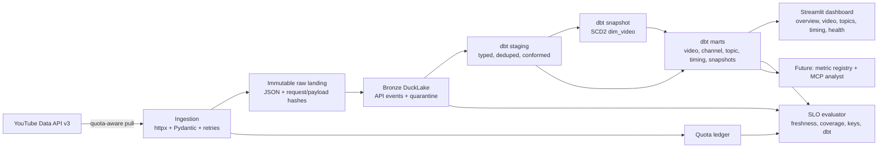

# Architecture

Breakout is a local-first creator intelligence lakehouse. It ingests public YouTube data, preserves the raw source of truth, models creator performance with dbt, and exposes the result through a dashboard and an SLO health check.

## Layers

| Layer | Technology | Responsibility |
|---|---|---|
| Source | YouTube Data API v3 | Public channel, video, statistics, and comment data |
| Ingestion | Python, httpx, Pydantic, tenacity | Quota accounting, retries, pagination, typed parsing |
| Raw landing | JSON on local disk | Immutable API envelopes, replay, audit |
| Bronze | DuckLake + DuckDB | Idempotent events, quarantine, schema-on-read |
| Silver | dbt views + snapshot | Typed staging, SCD2 video dimension, age-adjusted metrics |
| Gold | dbt tables | Video performance, channel overview, topics, timing, snapshot deltas |
| Orchestration | Dagster | Assets, checks, schedule, run metadata |
| Consumption | Streamlit + Plotly | Five product pages and a health page |
| Reliability | `breakout health`, CI, runbook | SLOs, quarantine review, failure playbooks |

## Data flow

1. **Pull.** `YouTubeClient.collect` resolves the channel, pages the uploads playlist, batches `videos.list` calls in groups of 50, and optionally pulls top comments.
2. **Preserve.** Every response is written to `data/raw/endpoint=.../dt=.../<response_id>.json` before parsing.
3. **Land.** The raw envelope and parsed rows are upserted into DuckLake bronze tables. Malformed items go to `bronze.quarantine`.
4. **Model.** dbt stages the bronze tables, snapshots `dim_video`, computes age-adjusted performance, and builds the gold marts.
5. **Consume.** The dashboard reads the gold marts. `breakout health` evaluates SLOs from bronze, gold, the quota ledger, and dbt artifacts.
6. **Operate.** Dagster runs `ingest -> dbt_models -> pipeline_health` daily at 06:00 UTC and records run metadata and checks.

## Key invariants

- **Raw is immutable.** No downstream bug requires a re-fetch.
- **Writes are idempotent.** Replaying the same response or collection changes no row counts.
- **Quota is bounded.** The ledger refuses calls above 80% of the daily budget.
- **Malformed rows are quarantined, not dropped.** The raw payload remains available for replay.
- **Metrics are age-adjusted.** Raw views/day biases toward recent uploads; the breakout score compares each video with its channel and age bucket.
- **SLOs are executable.** `breakout health` exits non-zero on error-severity failures.
- **AI is governed by design.** The future metric registry only exposes defined metrics; no raw text-to-SQL.

## Data model

| Table | Grain | Notes |
|---|---|---|
| `bronze.api_responses` | one API response | Request, payload, and response hashes |
| `bronze.channels` | channel + snapshot | Subscriber/video/view counts |
| `bronze.videos` | one video | Current metadata, upserted |
| `bronze.video_snapshots` | video + snapshot | Append-only statistics |
| `bronze.comments` | one comment | Hashed authors, plain text |
| `bronze.quarantine` | rejected item | Reason + payload hash |
| `silver.dim_video` | one video per version | dbt snapshot, SCD2 |
| `gold.mart_video_performance` | one video | Age-adjusted score, label, rank |
| `gold.mart_channel_overview` | one channel | Aggregate scorecard |
| `gold.mart_topic_performance` | channel + topic | Volume, breakout rate, median score |
| `gold.mart_publish_timing` | channel + day + hour | Suppressed below 3 videos |
| `gold.mart_video_snapshots` | video + snapshot | Deltas and views/hour when history exists |

## Tradeoffs

The full decision record is in `docs/adr/`:

- [0001: daily micro-batches, not streaming](adr/0001-batch-vs-streaming.md)
- [0002: DuckLake locally, Iceberg as the production path](adr/0002-ducklake-vs-iceberg.md)
- [0003: Dagster for orchestration](adr/0003-dagster-vs-airflow.md)
- [0004: DuckDB locally, Snowflake as the parity target](adr/0004-duckdb-vs-snowflake.md)
- [0005: a small metric registry before a semantic layer](adr/0005-metric-registry-vs-semantic-layer.md)
- [0006: preserve raw API responses before parsing](adr/0006-raw-landing-before-parsing.md)

## What this architecture is not

- Not a streaming system. The source is polled.
- Not multi-tenant. One local DuckDB process.
- Not a production deployment. The public demo is a snapshot.
- Not an AI product yet. The metric registry and MCP analyst are a documented next step.
